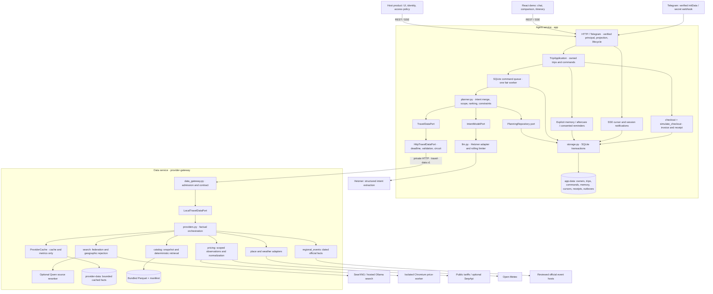
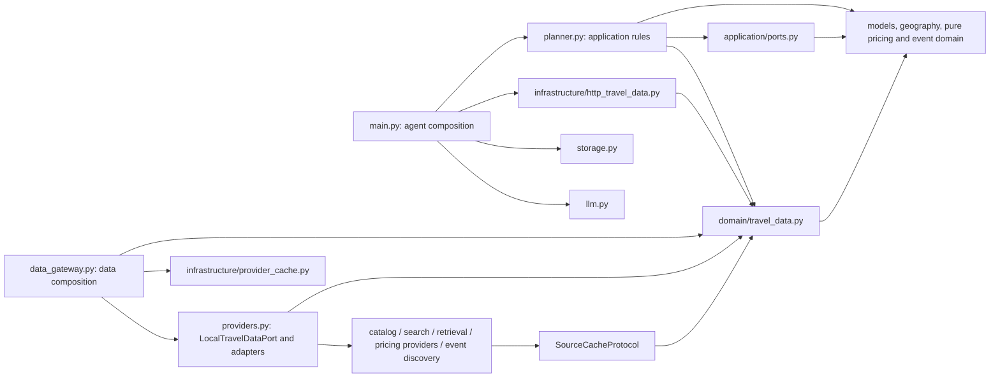
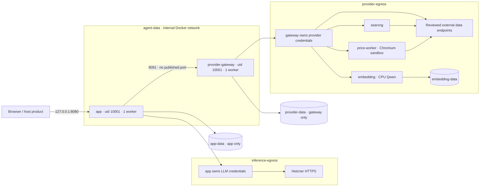
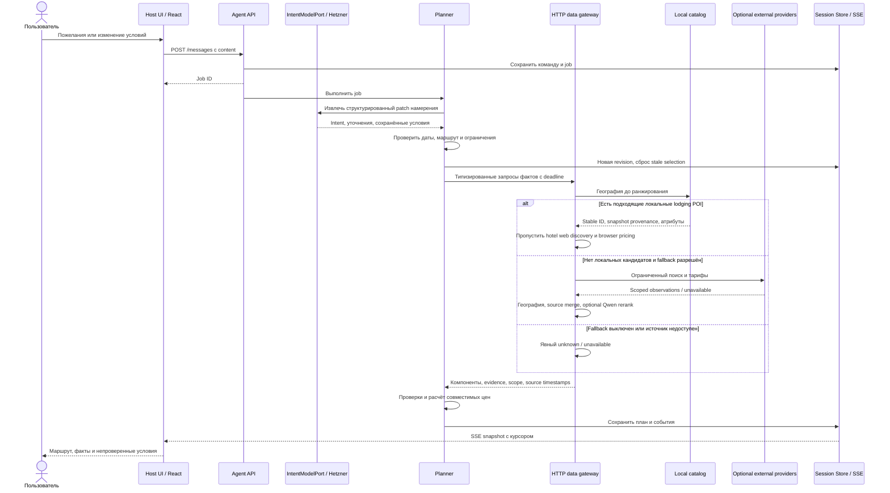
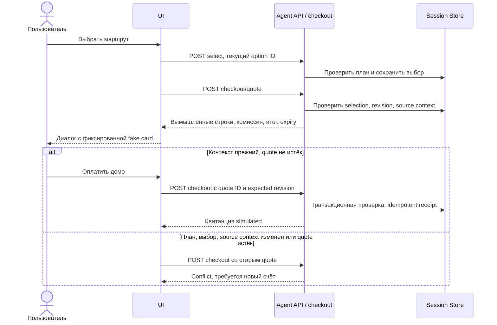

# Архитектура модуля «Один запрос»

Агент встраивается в продукт через REST/SSE либо как FastAPI-подприложение. Он владеет состоянием поездки, намерением, проверками и демооформлением. Получение фактов вынесено в отдельный `provider-gateway`: замена источника не требует изменения планировщика. Inference-модель и поисковая similarity не служат источниками цены или подтверждением условий.

Compose запускает agent и gateway как отдельные сервисы. Независимый
[сервис подбора перелётов](browser-flight-search.md) работает параллельно первичному
поиску проживания. Источники и Chromium находятся за границей `TravelDataPort`,
а агент владеет состоянием поездки и inference limiter.

## Граница приложения

Композиция использует FastAPI, SQLite, React и отдельный gateway. Новый брокер, отдельный auth-сервис или второй planner не добавлены. Состояние пользователей, команд, памяти и Telegram принадлежит только агенту.

`TripApplication` содержит общие операции поездки для HTTP и Telegram; `AgentDependencies` задаёт фабрики repository/model/data и доверенный resolver principal. Default composition создаёт единственный LLMClient, который также получает KnowledgeTravelDataPort. Один lifespan закрывает worker и каналы перед портами, клиентом и SQLite. Mounted host передаёт dependencies через `examples.host_integration.create_host` и явно запускает child lifespan. Несколько независимых inference runtimes под одним ключом этот API не координирует.

Доступ теперь проверяется приложением: пользователь владеет поездкой; задания, SSE, память и чеки наследуют эту границу. Старые строки мигрируют к non-login legacy owner без смены ID и доказательств источников. Ссылка на поездку и курсор SSE не являются полномочиями. Guest/Telegram используют12-часовую cookie и CSRF; host resolver должен получать identity только от проверенного middleware. Это реализованная изоляция PoC, а не обещание промышленной IAM-платформы.

Единственная постоянная очередь в SQLite допускает одну выполняемую команду, две ожидающие на пользователя и32 ожидающие суммарно. Повторный ключ с тем же payload возвращает прежнюю команду. После рестарта возобновляются только ещё не запущенные команды; неопределённое выполнявшееся действие становится interrupted. Отмена/удаление запрещают позднюю запись. Результат и terminal job публикуются одной транзакцией. Trace parent хранится только в ограниченной памяти worker, без payload и baggage; восстановленная после рестарта команда получает новый trace.

Модель предлагает только clarify/explore/refine/compare/explain. Явные compare/explain читают сохранённые факты без inference и provider calls. Изменённый intent инвалидирует выбор/checkout; прежний план сохраняется только для чтения с собственными датами и источниками. Gateway возвращает ограниченные реальные варианты объектов; planner выбирает максимум3 из9 кандидатов. Одна optional price-extraction batch разделяется параллельными кандидатами, используя существующий LLM limiter.

Одобренная пользователем память применяется только по явному opt-in для новой поездки. Разрешены origin, currency, climate_preferences, trip_styles, direct_flight_preferred, max_travel_minutes и pets; даты, бюджет и состав группы не запоминаются как устойчивые настройки. Явные текущие значения и отрицания имеют приоритет. Экспорт не содержит access tokens, job payload или сырых страниц. Удаление сохраняет минимальные tombstones против поздних записей.

Telegram — тонкий вход в те же команды, не отдельный агент. Webhook проверяет secret до parsing, polling включается отдельно. Inbox и короткие ответы сохраняются в SQLite; ACK не считается доставленным результатом. Неопределённая доставка не повторяется автоматически. Браузер и Mini App используют один frontend и те же owner-scoped API.

Mini App использует Secure/None/Partitioned cookies и подтверждает bootstrap через собственную сессию до чтения поездки и подключения SSE. Новый вход требует подписанного запуска не старше300с. Старый запуск может только восстановить уже действующую сессию: полная проверка HMAC, точное существующее соответствие Telegram-пользователя, cookie и CSRF обязательны; новые credentials и продление12-часового срока запрещены. Без действующей сессии интерфейс предлагает закрыть Mini App и открыть его из бота. Ошибка входа не создаёт гостевую identity.


## 1. Компоненты и ответственность



`Planner` получает три порта; `main.py` соединяет их с HTTP, Hetzner и SQLite. Шлюз получает конкретные адаптеры и отдельный кеш. Shared DTO содержат предметные модели и Pydantic, но не импортируют HTTP, DuckDB, Store или LLM.

| Граница | Реализация | Что заменяется без изменения Planner |
|---|---|---|
| Данные путешествия | [TravelDataPort](../backend/app/domain/travel_data.py), [HttpTravelDataPort](../backend/app/infrastructure/http_travel_data.py) | Supplier API, корпоративный каталог, fixtures |
| Намерение | [IntentModelPort](../backend/app/application/ports.py), [Hetzner adapter](../backend/app/llm.py) | Провайдер структурированного извлечения |
| Состояние планирования | [PlanningRepository](../backend/app/application/ports.py), [Store](../backend/app/storage.py) | Операции состояния планировщика |
| Факты и кеш | [LocalTravelDataPort](../backend/app/providers.py), [ProviderCache](../backend/app/infrastructure/provider_cache.py) | Источник/кеш внутри data service |
| HTTP-модуль | [create_app](../backend/app/main.py), [host example](../examples/host_integration.py) | Способ подключения к продукту |

Repository port покрывает зависимости **планировщика**. Полная замена SQLite во всём API потребует адаптации транзакций команд, SSE и checkout: `create_app` пока создаёт конкретный Store. Готового универсального storage plugin или выделенного Python SDK здесь нет. Версионированные DTO пока живут в общем репозитории и образах.

## 2. Направление зависимостей

Стрелка означает Python dependency. Composition roots импортируют конкретные реализации; предметные правила их не импортируют.



[Import/AST tests](../backend/tests/test_host_integration.py) проверяют эти границы в чистом процессе. Агентский Docker-образ физически исключает providers, каталог, DuckDB, search, retrieval и event discovery. Образ шлюза исключает `main`, `planner`, `llm`, session Store и frontend. Это делает раздельный запуск проверяемым.

## 3. Compose: процессы, сети, данные и секреты



[Compose](../docker-compose.yml) использует отдельные networks и явные environment allowlists. Только `app` получает `LLM_API_KEY`; только шлюз — `OLLAMA_API_KEY`, `SERPAPI_API_KEY`, адреса encoder/search/worker. Шлюз не монтирует `app-data`. Его SQLite создаёт только `cache` и `metrics`: полезный объём кеша 64 MiB, до 10 000 записей и 2 MiB на значение. Файл SQLite/WAL может занимать больше логического лимита.

`agent-data` имеет `internal: true`. Egress-сети разделяют dependency membership, но обычная Docker bridge-сеть **не ограничивает произвольный исходящий HTTPS**. Это не host allowlist firewall или защита от скомпрометированного процесса. Production egress policies, authentication gateway и ownership сессий принадлежат host-интеграции. Здесь gateway доверяет приватной Compose-сети и не публикуется наружу.

У сервисов non-root, `cap_drop: ALL`, `no-new-privileges`, healthchecks; у data service и тяжёлых workers есть CPU/memory limits. `app` ждёт готовности шлюза при старте; последующая потеря шлюза не останавливает чтение поездок. `/health` шлюза проверяет SQLite, `/ready` — capabilities; готовность не подтверждает внешний inventory. Дополнительный сетевой hop и контракт — цена независимого жизненного цикла данных и user state.

Лимит Hetzner остаётся у одного `app` worker: 10 dispatches за rolling 60 секунд, включая repair/retries. Gateway не вызывает LLM. Source singleflight, очередь gateway и circuit breaker тоже процессные. Распределённого счётчика между процессами нет; несколько независимо запущенных агентов не координируют общий лимит ключа.

## 4. Контракт и отказоустойчивость

[Контракт travel-data.v1](TRAVEL_DATA_CONTRACT.md) реализован в DTO, gateway и HTTP adapter. Запрос несёт operation, request ID, SHA-256 fingerprint нормализованного payload и UTC deadline. Ответ обязан совпасть по версии, operation, request ID и fingerprint. Fingerprint связывает ответ с параметрами и не является подписью или авторизацией.

| Операция | Endpoint | Общий дедлайн, секунд |
|---|---|---:|
| resolve_place | POST `/v1/places/resolve` | 8 |
| weather | POST `/v1/weather` | 18 |
| search | POST `/v1/search` | 22 |
| inventory | POST `/v1/inventory` | 45 |
| refresh_inventory | POST `/v1/inventory/refresh` | 45 |
| regional_events | POST `/v1/events` | 12 |
| capabilities | GET `/v1/capabilities` с contract headers | 2 |

`DataIntent` передаёт места, даты, состав путешественников, комнаты, валюту и ограничения. История чата, session ID, бюджет и секреты поставщику не нужны. Команды не принимают URL назначения, SQL или путь файла. Refresh передаёт текущие типизированные компоненты и source context, сохраняя fixed entity и область цены. Evidence URL остаётся доказательством, а не командой выполнить произвольный HTTP-запрос.

Request ограничен 256 KiB, response2 MiB; лишние поля и нечисловые float запрещены. Клиент не следует redirects и не делает скрытых retries. `asyncio.timeout` включает очередь, сеть и чтение stream. Gateway допускает до 32 принятых запросов и 8 выполняющихся операций; pricing pool ограничен 8 source tasks/16 singleflight contexts. Отмена последнего waiter отменяет source task, а запрос другого живого waiter сохраняется.

После трёх последовательных транспортных/validation-сбоев в пределах 30 секунд клиент открывает circuit на 10 секунд; успешный ответ сбрасывает счётчик. Недоступность даёт типизированные unknown/unavailable результаты; `unavailable` envelope не может содержать данные. Существующий план не получает выдуманную цену или другой отель. Автоматического перехода на встроенные providers в агенте нет. Source cache допускает сохранённые факты только по своей policy, с исходными timestamps и явной пометкой.

## 5. Планирование, retrieval и fallback



Диаграмма группирует несколько параллельных data-операций. Local-first ветвь относится к проживанию; транспорт, погода и события имеют собственный контекст и разрешённый fallback. Для проживания используется **назначение**, для транспорта — **маршрут**, для событий — назначение и точное календарное окно.

В каталоге нет векторной БД. Parquet читается DuckDB, проверяется по manifest и загружается ограниченным набором записей. Eligibility по расстоянию предшествует стабильному ранжированию. Другой путь обрабатывает веб-ссылки: federation → geographic rejection → URL deduplication → optional Qwen embedding rerank, с encoder deadline8 секунд и fallback к исходному порядку.

Это не классический RAG, где retrieved hotel passages добавляются в prompt для генерации ответа. Hetzner извлекает intent из диалога; факты инструментов проверяет и отображает программа. Генерация не создаёт inventory. Vector DB для 1 300 строк добавила бы инфраструктуру без измеренной необходимости. При росте данных каталог можно заменить за тем же портом и измерить качество/latency заново; качество нового способа поиска нужно измерять отдельно.

## 6. Согласованность выбора и демооплата



Счёт использует демологику сервера и целые центы. Его суммы не являются тарифами поставщика или budget coverage. Реальные данные карты не собираются, payment gateway нет. Проверки ревизии/срока/source context сохраняются даже в симуляции. [Реализация](../backend/app/checkout.py), [контракт демоцены](DEMO_PRICING_CONTRACT.md).

## 7. Подключение модуля

**HTTP-интеграция** подходит продукту на любом языке: поднимите data stack и agent API, направьте authenticated host backend к [командам и SSE](API_CONTRACT.md), свяжите trip ID со своим пользователем и настройте proxy timeout для SSE. Внешнему клиенту gateway не нужен.

**FastAPI mount** реализован в [examples/host_integration.py](../examples/host_integration.py):

```python
from examples.host_integration import create_host

# Использует PROVIDER_GATEWAY_URL; ресурсы модуля принадлежат host lifespan.
app = create_host(database_path="data/travel.sqlite3")
# /health — host, /travel/health — модуль, /travel/api/sessions — сессии.
```

Пример явно входит в `travel_agent.router.lifespan_context`: mounted subapplication не запускает lifespan автоматически. Host UI использует `/travel/api/...`. Встроенный React demo имеет абсолютные API paths и обслуживается Compose app в корне; готовым embeddable widget он не является.

**Другой поставщик** подключается на одном из уровней:

- `create_app(travel_data_factory=lambda client: MyTravelDataPort(...))` — заменить data boundary для host API или тестов.
- `create_gateway_app(port_factory=lambda client, cache: MyTravelDataPort(...))` — сохранить HTTP boundary, заменив supplier orchestration на стороне данных.
- Сохранить `LocalTravelDataPort`, добавив специализированный adapter внутри gateway.

Фабрика возвращает реализацию операций data port; приватный шлюз дополнительно поддерживает `price_documents` из018. Явные host-адаптеры сохраняются без автоматического обогащения. Необязательный async `aclose` вызывается при завершении. При сбое gateway app не импортирует локальные providers. [Host smoke и import guards](../backend/tests/test_host_integration.py), [HTTP contract tests](../backend/tests/test_http_travel_data.py), [gateway tests](../backend/tests/test_data_gateway.py).

В штатной композиции018 `KnowledgeTravelDataPort` оборачивает HTTP-порт. Для недостающих цен шлюз выполняет общий поиск и загрузку страниц через существующий hosted search/fetch. Единственный LLMClient агента извлекает цены одним пакетом через общий с планированием лимитер10/60с; планировщик получает обычные компоненты. Код проверяет цитаты, сумму, валюту, единицу и объект/маршрут. Результаты остаются опубликованными references без нормализации в бюджет; документы не попадают в сессии и трассы. [Контракт цен и источников](API_CONTRACT.md).

## 8. Данные и ограничения

Release `cyprus-lodgings-20261025-v2`: 1 300 именованных OSM source POI, 682 hotel-kind; 20 независимых Wikidata entity records. Это source-ID uniqueness, а не доказанная уникальность действующих предприятий. Восемь пересекающихся 8-км circles не суммируются. Виллы/здания не объединяются по похожему имени. Координаты way/relation приблизительны. Snapshot датирован 2026-10-24T20:20:51Z; acquisition и source modification timestamps сохраняются отдельно.

Exact Wikidata ID позволяет хранить независимые claims, не перезаписывая OSM. Две конфликтующие связи остаются `name_conflict` и `coordinate_conflict`; чужой website/OTA не становится официальным hotel URL. Цены, наличие и неизвестные условия остаются unknown. [Manifest](../backend/app/catalog/assets/cyprus/manifest.json), [лицензии](../backend/app/catalog/assets/cyprus/LICENSE.md), [builder](../scripts/build_cyprus_catalog.py). Rebuild работает offline; acquisition выполняет оператор с сохранением hashes/revisions. V1 из 009 сохранён byte-for-byte в архиве.

Нет распределённого лимитера, автоматического масштабирования, production multi-tenant identity, подтверждённого real booking или payment gateway. Поиск не доказывает применимость тарифа, snapshot не гарантирует действующий отель. Разделение на сервисы решает заменяемость источников и изоляцию состояния; ограничения источников остаются явными в контракте и UI.

## Основания решений

Порты направляют зависимости к приложению, заменяемые адаптеры остаются снаружи — [Hexagonal Architecture, Alistair Cockburn](https://alistair.cockburn.us/hexagonal-architecture). Для mount используется явный lifespan по [FastAPI: Sub Applications](https://fastapi.tiangolo.com/advanced/events/#sub-applications). Общий deadline оборачивает вызов, поскольку [HTTPX timeouts](https://www.python-httpx.org/advanced/timeouts/) ограничивают отдельные сетевые стадии. Эти принципы проверяются кодом и тестами.

